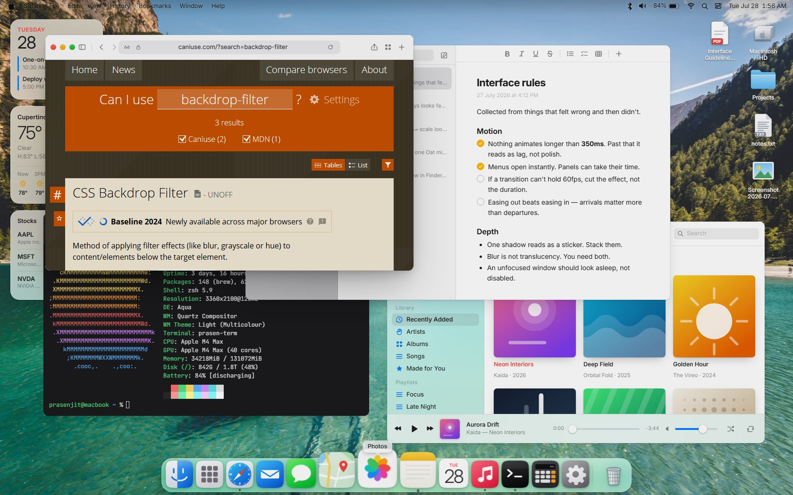
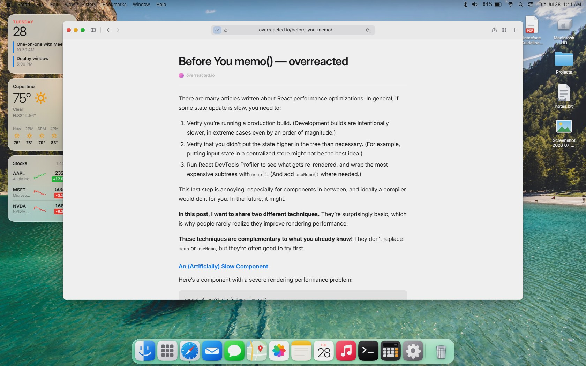
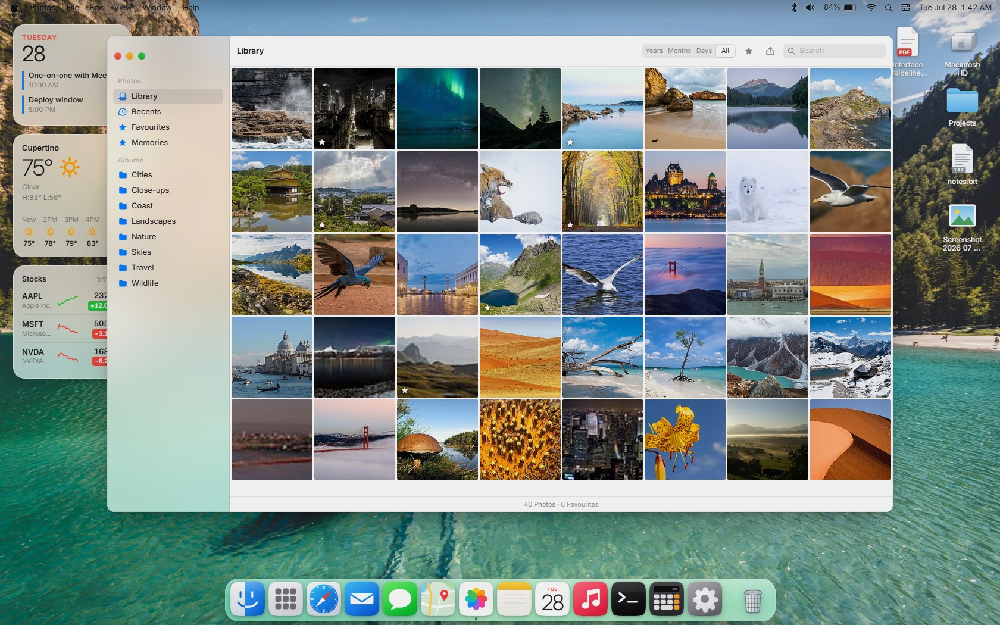
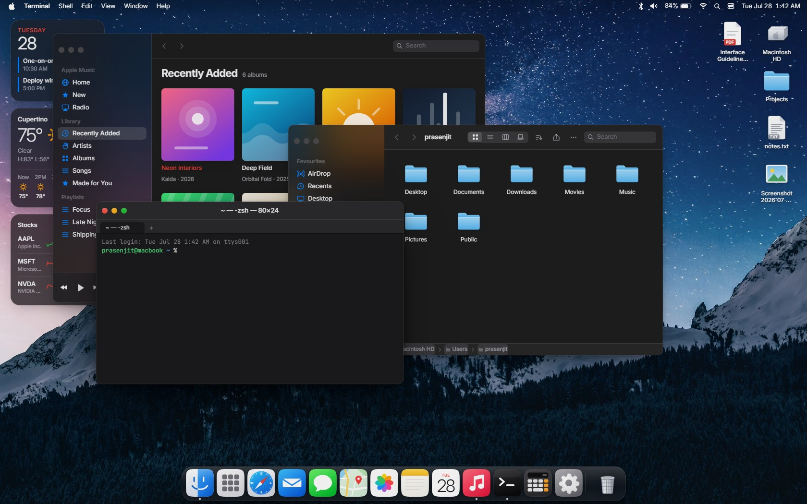

# macos-web

A macOS desktop environment that runs in a single HTML file. One document, no build step, no bundler, no framework: markup, one stylesheet, and plain JavaScript.

**[Try it](https://starknightt.github.io/macos-web/)**



Thirty apps, a window manager, a dock that magnifies on a parabolic falloff, and a menu bar that adapts its ink to the wallpaper behind it. Several apps talk to real services, so the weather is the actual forecast, the map is a real slippy map, and the browser genuinely browses.

## Running it

Open `index.html` in a browser. That is the whole setup.

Two things want an HTTP origin rather than the filesystem: YouTube refuses to embed a player into a `file://` page, and some browsers apply stricter cross-origin rules to local documents. The [hosted copy](https://starknightt.github.io/macos-web/) has both, or serve the folder yourself:

```bash
python -m http.server 8080
# then open http://localhost:8080
```

Chromium and Safari are the targets. Firefox works, but its `backdrop-filter` implementation renders the glass surfaces slightly differently.

## What is in it

**System.** Boot sequence and lock screen, light and dark appearance with an Auto mode that follows the host OS, nine accent colours and a separate highlight colour, six wallpapers with a two-stage loader, Spotlight, Launchpad, Notification Centre with live widgets, Control Centre, and a menu bar whose extras all open real menus.

**Window management.** Drag, eight-way resize, zoom, genie minimise along a Bézier path, traffic lights with hover reveal, per-app menu bars, window cycling, and a dock with running indicators and bounce-to-open.

**Applications.** Finder (icon, list, column and gallery views over a virtual file system), Safari, Terminal, Notes, Mail, Messages, Calendar, Photos, Music, Maps, Weather, Stocks, Reminders, Contacts, FaceTime, Voice Memos, Freeform, Podcasts, TV, Books, App Store, Clock, Calculator, TextEdit, Preview, System Settings, Activity Monitor, Disk Utility, Font Book, and About This Mac.

## Things that are actually real

Rather than mock every service, the apps that benefit from live data use public APIs.



**Safari** resolves whatever you type. Sites that permit embedding load in a frame; everything else is fetched through a text extractor and rendered as type, the way Reader does. Wikipedia is rendered by hand from its REST API, search goes through the Wikipedia search API, and YouTube links become real players when served over HTTP. There is a start page with favourite tiles, a bookmarks sidebar, and a tab bar that only appears once a second tab exists.

**Photos** loads forty featured pictures from Wikimedia Commons through a throttled, retrying loader, and its search box can pull more from Commons into the library.



**Weather** uses Open-Meteo for current conditions, hourly and seven-day forecasts, mapped from WMO codes to hand-drawn glyphs. **Maps** is a real slippy map on CARTO basemap tiles with geocoding through Nominatim. **Music** synthesises its catalogue live on the Web Audio API: two oscillators per voice, a filter envelope, reverb, delay and a limiter, with a deterministic arrangement per track. **Calendar** creates, edits, moves and deletes events across day, week, month and year views.



## How it is organised

`index.html` is about ten thousand lines, in numbered sections: design tokens, the icon sprite sheet, system state, the window manager, the desktop shell, then one section per app, then startup. The CSS is a single sheet at the top, driven by custom properties so that appearance, accent and highlight changes are a variable write rather than a re-render.

A few decisions that shaped the rest:

- Animation budget is 350 ms. Past that, motion reads as lag rather than polish.
- Blur is expensive, so surfaces that blur on first paint are pre-warmed off-screen before they are shown.
- Windows carry four separate shadows. Collapsing them into one makes a window read as a rectangle with a blur under it instead of an object in a room.
- Every control does something. There is a test that checks this.

## Tests

The suites drive the real DOM through Playwright and assert on observable state.

```bash
npm install

npm test               # 298 functional checks across every app
npm run test:dead      # clicks every control and reports any that do nothing
npm run test:fps       # frame times for dock magnification, Launchpad, genie, and more
npm run test:wallpaper # wallpaper switching, including rapid switching and dead URLs
npm run test:audio     # measures real RMS and peak from the synthesiser's output
npm run test:cursors   # verifies the custom cursor art resolves at every hotspot
```

`node shot.mjs <scenario>` captures a named screenshot; `node shot.mjs` with no argument lists what is available. Screenshots run headed on purpose, because headless Chromium rasterises in software and silently drops `blur()` inside `backdrop-filter`, which makes every glass surface photograph flat.

## Credits

Wallpapers from [Unsplash](https://unsplash.com). Photo library from [Wikimedia Commons](https://commons.wikimedia.org) featured pictures, loaded at runtime under their own licences. Article text from the [Wikipedia REST API](https://en.wikipedia.org/api/rest_v1/) under CC BY-SA 4.0. Forecasts from [Open-Meteo](https://open-meteo.com). Map tiles from [CARTO](https://carto.com) and [OpenStreetMap](https://www.openstreetmap.org) contributors, geocoding from [Nominatim](https://nominatim.org).

Not affiliated with Apple. macOS, Safari, Finder and the other application names are trademarks of Apple Inc., used here to describe what is being reproduced.

## Licence

MIT. See [LICENSE](LICENSE).
